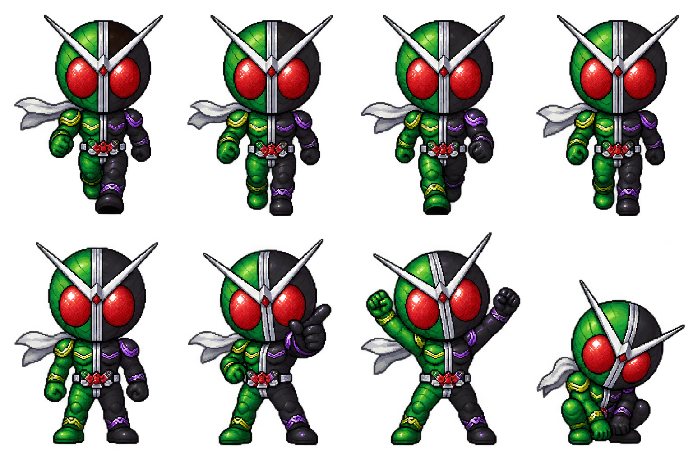

# 假面骑士 W · 风都桌宠

Windows 独立桌宠，疾风王牌配色、Q 版像素精灵。双击 **WDesktopPet.exe** 即可运行，无需 Python，无需联网。需要 Windows 自带的 .NET Framework 4.x。

[下载 Windows 可执行文件](https://github.com/allsterisk/WDesktopPet/raw/refs/heads/main/WDesktopPet.exe)

## 操作

- 按住角色拖动：移动到桌面任意位置，松开后保留位置。
- 单击：跳跃、切换指向和欢呼动作，随机显示一句台词。
- 右键角色或托盘图标：暂停/开启自由散步、休息、切换三档大小、复位、退出。
- 双击托盘图标：唤醒并回到鼠标所在屏幕的右下角。

默认置顶、透明背景、不占任务栏。散步保持当前高度，在所在显示器的工作区内折返。支持副屏的负坐标，调整显示器后自动收回可见范围。休息时保持蹲坐。重复启动只保留一个实例。

位置、大小、散步偏好保存在 `%LOCALAPPDATA%\WDesktopPet\settings.txt`。不设置开机启动，不访问网络。退出通过右键菜单完成。

## 源码与检查

- `Pet.cs`：WinForms 透明分层窗口、动画和交互。
- `assets/w-sprites.png`：4 列 × 2 行，透明精灵图，已嵌入 exe；单独复制 exe 也能运行。
- `build.ps1`：使用 Windows 自带 C# 编译器构建：`powershell -ExecutionPolicy Bypass -File .\build.ps1`。
- `WDesktopPet.exe --self-test`：无窗口渲染检查，生成 `verification` 文件夹；`result.txt` 为检查结果。

已验证编译、8 个动作帧、透明背景、气泡绘制及多屏位置边界。桌面拖动、托盘菜单及不同 DPI 下的显示效果需实际启动确认。

这是一款个人同人桌宠，角色属于其原权利人。素材通过内置 imagegen 工具生成，提示词保存在 `assets/prompt.txt`。

## 许可证

本项目的原创程序代码、构建脚本和说明文档采用 [MIT License](LICENSE)，允许在保留许可证及版权声明的前提下使用、修改和分发。

`assets/` 目录及可执行文件内嵌的角色精灵图不在 MIT 授权范围内。假面骑士 W 的角色、名称、标识及其他第三方权利归原权利人所有，本项目不授予这些权利。素材范围详见 [assets/NOTICE.md](assets/NOTICE.md)。
