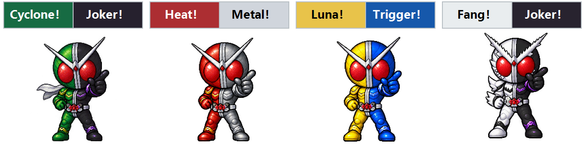

# 假面骑士 W · 风都桌宠

Windows 独立桌宠，支持四套假面骑士 W 形态与 Q 版像素精灵。普通台词使用统一深色对话框，仅变身台词使用当前皮肤的左右双色对话框。双击 **WDesktopPet.exe** 即可运行，无需 Python，无需联网。需要 Windows 自带的 .NET Framework 4.x。

[下载 Windows 可执行文件](https://github.com/allsterisk/WDesktopPet/raw/refs/heads/main/WDesktopPet.exe)

## 皮肤与对话框

右键角色或托盘图标 → **切换皮肤**，即可切换，菜单勾选项代表当前皮肤。

| 皮肤 | 变身对话框左侧 | 变身对话框右侧 |
| --- | --- | --- |
| 疾风王牌 CycloneJoker | 绿色 | 黑色 |
| 炽热金属 HeatMetal | 红色 | 银色 |
| 月神扳机 LunaTrigger | 黄色 | 蓝色 |
| 獠牙王牌 FangJoker | 白色 | 黑色 |

每套皮肤均包含八帧动作。切换时，角色、变身台词、菜单标题和托盘图标同步更新；保留当前大小、位置及休息状态。仅显示当前形态的变身台词（例如 `Cyclone！Joker！`）时，对话框才使用双色，两段记忆体名称在左右两侧分别居中，文字与分界线之间保留间距，按各侧背景选择深色或浅色文字。普通互动、休息和唤醒台词均使用无分界线的深色对话框。退出重启后会恢复上次选择的皮肤。

## 操作

- 按住角色拖动：移动到桌面任意位置，松开后保留位置。
- 单击：跳跃、切换指向和欢呼动作，随机显示一句台词。
- 右键角色或托盘图标：切换四套皮肤、暂停/开启自由散步、休息、切换三档大小、复位、退出。
- 双击托盘图标：唤醒并回到鼠标所在屏幕的右下角。

默认置顶、透明背景、不占任务栏。散步保持当前高度，在所在显示器的工作区内折返。支持副屏的负坐标，调整显示器后自动收回可见范围。休息时保持蹲坐。重复启动只保留一个实例。

位置、大小、散步偏好和所选皮肤保存在 `%LOCALAPPDATA%\WDesktopPet\settings.txt`。兼容原版的设置文件。

不设置开机启动，不访问网络。退出通过右键菜单完成。

更新时先从右键菜单退出旧版，再启动新版 exe。

## 许可证

本项目的原创程序代码、构建脚本和说明文档采用 [MIT License](LICENSE)，允许在保留许可证及版权声明的前提下使用、修改和分发。

`assets/` 目录及可执行文件内嵌的角色精灵图不在 MIT 授权范围内。假面骑士 W 的角色、名称、标识及其他第三方权利归原权利人所有，本项目不授予这些权利。
